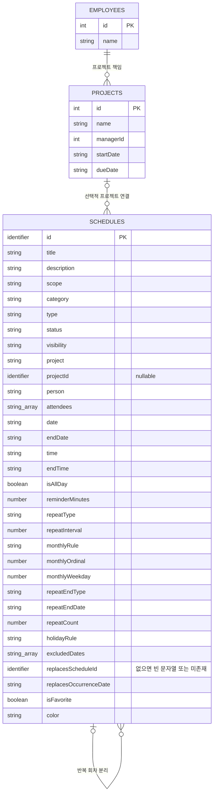

# 일정관리 ERD와 연동 설계

기준일: 2026-11-04. 현재 코드는 브라우저 저장소를 사용한다. 아래 현재 구조는 DB 생성 스크립트가 아니라 저장 필드와 논리적 연결을 설명한다. 전체 필드의 값·검증 조건은 [데이터 명세](./SCHEDULE_DATA_SPEC.md)를 참고한다.

## 1. 현재 구조 — 전체 ERP 도표에 보완할 일정 영역

`PROJECTS`와 `EMPLOYEES`는 기존 ERP 도표의 일부 속성만 다시 표시했다. 일정 연결선은 코드에서 참조하는 관계이며, DB 외래키 제약이 구현됐다는 뜻은 아니다. 기존 일정 ID는 숫자·문자열 모두 허용하므로 `identifier`로 표시한다.

| 관계·항목 | 현재 코드에서의 의미 |
|---|---|
| `PROJECTS.id → SCHEDULES.projectId` | 일정당 연결 프로젝트는 최대 한 개. 프로젝트 없이 개인·일반 업무 일정 등록 가능 |
| `PROJECTS.managerId → EMPLOYEES.id` | Context의 직원 목록으로 프로젝트 책임자 이름만 조회. 일정의 담당자와 별개 |
| `replacesScheduleId` | 분리 회차가 원본 반복 일정을 가리킴. 원본 ID와 같은 자료형을 가질 수 있음 |
| `replacesOccurrenceDate` | 휴일 이동 전의 규칙상 발생일. 실제 표시일과 다를 수 있음 |
| `excludedDates` | 삭제하거나 분리한 원래 회차 날짜 배열. 휴일 이동 후 날짜를 저장하는 항목이 아님 |
| `person`, `attendees` | 현재는 이름 기반. 직원 테이블과 직접 연결하는 FK가 아님 |
| `project`, `projectId` | 수정·저장 시 ID를 우선해 연결을 유지하고 현재 이름을 반영. ID 없는 이전 일정은 이름으로 연결. 직접 입력 변경 시 이전 ID를 해제 |
| 프로젝트 시작·마감일 카드 | `createProjectMilestones`가 계산한 읽기 전용 항목. `SCHEDULES`에 중복 등록하지 않음 |

`occurrenceDate`, `multiDayOccurrence`, `originalStartDate`, `projectManager`, `isProjectMilestone`, `milestoneType`은 표시·변환에 쓰는 정보이며 일반 저장 일정의 신규 DB 컬럼으로 그대로 추가하지 않는다. `color`는 현재 저장 필드이지만 `type`에서 계산 가능하므로 DB 전환 시 중복 저장 여부를 결정한다.

저장 일정 하나에서 여러 날짜 카드가 생성될 수 있다. 월간 달력의 카드 수를 원본 일정 건수나 DB 행 수로 취급하지 않는다.

## 2. DB 연동 설계안 — 현재 미구현

| 설계 대상 | 권장 형태 | 현재 자료와의 차이 |
|---|---|---|
| 일정 기본키 | 기존 ID를 보존하거나 서버 ID와 기존 ID의 대응표 사용 | 정수로 일괄 변환하면 문자열 ID와 회차 연결이 깨질 수 있음 |
| 프로젝트 | `SCHEDULES.projectId`를 선택적 FK로 사용 | 현재는 브라우저 저장값이며 FK 검증 없음 |
| 업무 담당자 | `SCHEDULES.employeeId`로 `EMPLOYEES.id` 참조, 개인 일정은 비워 두는 방향 | 현재 `person` 이름을 직원 ID로 변환해야 함 |
| 회의 참석자 | `SCHEDULE_ATTENDEES(scheduleId, employeeId)` 관계 테이블. 두 값 조합 중복 금지 | 현재 이름 배열 `attendees` 사용 |
| 반복 제외일 | `SCHEDULE_EXCLUSIONS(scheduleId, occurrenceDate)` 관계 테이블. 두 값 조합 중복 금지 | 현재 `excludedDates` 배열 사용 |
| 분리 회차 | `replacesScheduleId`와 `replacesOccurrenceDate`로 원본·기준 회차 추적. 같은 원본·회차의 대체 일정 중복 방지 | 현재 원본 제외일과 별도 일정으로 관리 |
| 일정 소유자 | 로그인 계정의 변경되지 않는 ID를 저장하는 `ownerAccountId` 후보 | 현재 소유자 필드와 서버 권한 검사 없음. 계정 테이블·ID 확정 필요 |
| 즐겨찾기 | 사용자별 공유 일정이라면 계정·일정 관계로 관리하는 방향 | 현재 `isFavorite`는 해당 브라우저 일정 객체의 값 |

`employeeId`와 `ownerAccountId`는 같은 개념이 아니다. 전자는 업무 담당 직원, 후자는 등록·소유 계정이다. 로그인 파일의 이름·아이디 문자열을 직원 기본키로 추정해서 연결하지 않는다.

## 3. 다른 파트와 확정할 조건

| 조건 | 확정할 내용 |
|---|---|
| 기존 이름 자료의 직원 변환 | 동명이인·미등록 이름을 임의 매칭하지 않고 사용자에게 확인할 방법 |
| 프로젝트 이름 변경·삭제 | 현재 수정·저장 시 ID와 최신 이름 유지. 삭제된 프로젝트는 기존 연결 정보를 보존하며, 향후 DB의 삭제 정책은 별도 협의 |
| 직원 퇴사·삭제 | 과거 일정 담당·참석 이력 보존 방법. 표시 이름과 참조 ID의 관리 방식 |
| 반복 원본 삭제 | 분리된 회차를 유지할지 함께 삭제할지 결정. 현재 동작과 데이터 이관을 함께 검토 |
| 개인 표시 | 계정 소유자와 서버 조회·수정 권한 검사 정의. `visibility` 필터만으로 접근 제한을 구현하지 않음 |
| 프로젝트 요약 | 현재 `projects[].schedules`는 일정 원본과 별도로 만들어지는 요약 사본. DB 전환 시 중복 저장보다 원본 참조·조회 방식 검토 |

이 문서는 5번 설계 보완이다. 직원·프로젝트·계정 데이터 변경, 저장 구조 이전, API·Context의 새 수정 기능은 구현하지 않았다. 현재 일정·팀원 자료도 변경하지 않는다.
